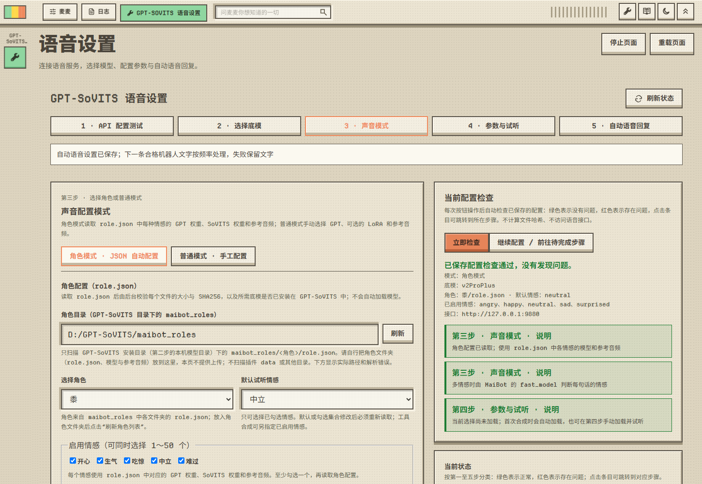

  

<h1 align="center">MaiBot GPT-SoVITS 语音合成插件</h1>

  
  
  

基于 [GPT-SoVITS](https://github.com/RVC-Boss/GPT-SoVITS) 的 **文本转语音** 插件，让 MaiBot（麦麦）用你指定的声音发送语音消息：语音模型 **CPU/GPU 本地部署**，几秒参考音频即可 **音色克隆**；多情感角色由 MaiBot 的 LLM 对每句话做 **情感分类**，自动切换对应语气的模型和参考音频。QQ 交流群：**1131116861**

---

## 功能

### 文本转语音

- **`/tts 文本`**：合成并发送语音，支持多行文本。
- **`gpt_sovits_speak` 工具**：用户要求“用语音说”时由大模型调用；角色模式下可传 `emotion`（支持 `happy`、`Happy`、`开心` 等写法，只会匹配到已启用的情感），不传时多情感角色由 LLM 判断。
- **自动语音回复**：在机器人发送文字前按概率或每 N 条转为语音，失败时照常发送文字；角色模式按每句话的情感选择对应模型。
- 通过 GPT-SoVITS 的 `api_v2.py` 接口合成 WAV，以 QQ 语音等 voice 消息发送；支持中文、英文、日文、韩文、粤语等语言（以所用 GPT-SoVITS 版本为准）。

命令、语音工具和自动语音的用法见 [使用](docs/usage.md)。

### CPU/GPU 本地部署

- GPT-SoVITS 运行在你自己的电脑上，语音合成不依赖云端 TTS 服务。
- 有 NVIDIA 显卡时用 CUDA 加速（RTX 50 系列有专用整合包）；没有显卡也能只用 CPU 运行（速度较慢，建议用 v2 / v2Pro 底模），macOS 可用 MPS。
- 也可以部署在局域网内的另一台电脑上，但插件需要能用相同路径访问 GPT-SoVITS 目录。部署步骤见 [部署 GPT-SoVITS](docs/gpt-sovits.md)，设置页第一步也有同样的教程。

### 音色克隆

- **普通模式**：一段 3～10 秒的参考音频加上它对应的文字即可克隆音色。参考音频放在 GPT-SoVITS 安装目录下的 `maibot_refs`，在第三步用下拉框选择。
- 想要更像，可以选用自己训练的 GPT 权重和 SoVITS 权重或 LoRA；支持 v1～v5 各版本底模，底模版本由第二步自动识别。
- **角色模式**：把训练好的角色放进 GPT-SoVITS 安装目录下的 `maibot_roles/<角色>/role.json`，每种情感可以有各自的 GPT 权重、SoVITS 权重和参考音频；设置页不提供网页上传。

参考音频的要求和 `role.json` 格式见 [音色克隆](docs/voice-cloning.md)。

### 情感分类

- 角色模式启用 2 个以上情感时，合成前由 MaiBot 已配置的 LLM 判断这句话属于哪个情感（开心、生气、难过、吃惊、中立，也可以是自定义情感），再用该情感的模型和参考音频合成。默认开启，可在第三步关闭或更换模型任务。
- 大模型调用语音工具时可以直接指定情感；自动语音优先使用消息自带的情感标记，LLM 分类失败时改用关键词规则，仍无法判断时使用默认情感。
- 同一句话 10 分钟内复用分类结果；第三步可以点“试判断”检查分类效果。详见 [情感分类](docs/emotion-classification.md)。

### 其他

- **五步设置页**：接口测试 → 底模 → 声音模式 → 参数与试听（试听可选）→ 自动语音；每一步完成后才能进入下一步。
- **`/tts_status`**：只读检查接口是否提供 `POST /tts`，不推理、不切换模型。
- **合成日志**：每次合成都会在 MaiBot 终端和 WebUI「日志」页输出“开始”和“结果”两行，包含来源、聊天、角色与情感（含 LLM 判断结果）、模型切换、各阶段耗时和音频大小。
- **安全限制**：聊天流白名单、冷却时间、字数上限；插件内单任务串行（忙时直接拒绝，不排队）；校验 WAV 完整性；不自动重试，不跟随重定向，不使用系统代理。

---

## 快速开始

1. **部署 GPT-SoVITS**：下载 Windows 整合包（或源码安装），启动 `api_v2.py`，浏览器能打开 `http://127.0.0.1:9880/docs` 即可。见 [部署 GPT-SoVITS](docs/gpt-sovits.md)。
2. **安装插件**：在 MaiBot WebUI「插件管理 → 从 ZIP 安装」导入发行包 `MaiBot-GPT-SoVITS-<版本>.zip`。见 [安装](docs/installation.md)。
3. **准备声音**：参考音频放进 GPT-SoVITS 安装目录下的 `maibot_refs`，或把角色文件夹放进 `maibot_roles`。见 [音色克隆](docs/voice-cloning.md)。
4. **完成五步设置**：打开顶部工作区 **GPT-SoVITS 语音设置**，依次完成接口、底模、声音模式、参数和自动语音。见 [五步设置](docs/setup-guide.md)。
5. **试一试**：在聊天中发送 `/tts 你好，这是一条语音合成测试。`，或对麦麦说“用语音说一句你好”。

---

## 文档

详细说明在 [docs](docs/) 文件夹中，发行包也附带这些文档。

| 文档 | 内容 |
|---|---|
| [安装](docs/installation.md) | 环境要求、导入 ZIP、用 install.ps1 安装或更新 |
| [部署 GPT-SoVITS](docs/gpt-sovits.md) | 下载 GPT-SoVITS、启动 api_v2.py、CPU / GPU 设置、底模选择与下载 |
| [五步设置](docs/setup-guide.md) | 设置页每一步的说明与截图、当前状态与配置检查 |
| [音色克隆](docs/voice-cloning.md) | 参考音频与角色文件放在哪里、角色模式与 role.json 格式 |
| [情感分类](docs/emotion-classification.md) | 多情感角色如何由 MaiBot 的 LLM 判断每句话的情感 |
| [使用](docs/usage.md) | /tts 命令、语音工具、自动语音回复、合成日志 |
| [配置项](docs/configuration.md) | config.toml 各项说明 |
| [常见问题](docs/faq.md) | 常见报错与解决方法 |
| [开发](docs/development.md) | 项目结构、测试、打包与截图脚本 |

---

## 更新日志

### 1.0.0

首个版本。

- 文本转语音：`/tts` 命令、`gpt_sovits_speak` 语音工具和自动语音回复，以 QQ 语音等语音消息发送。
- 本地部署：调用本机或局域网内 GPT-SoVITS 的 `api_v2.py`，支持 CPU / GPU；支持 v1～v5 各版本底模，版本自动识别。
- 音色克隆：普通模式使用 `maibot_refs` 中的参考音频；角色模式读取 `maibot_roles/<角色>/role.json`，每种情感使用各自的模型和参考音频，读取时校验文件大小、SHA256 与所需底模。
- 情感分类：多情感角色由 MaiBot 的 LLM 判断每句话的情感，失败时使用默认情感，不影响发送。
- 五步中文设置页：每一步完成后才能进入下一步，右侧实时显示状态与配置检查；另有合成日志与插件图标。

---

## 许可

MIT，见 [LICENSE](LICENSE)。GPT-SoVITS 及各模型权重遵循各自的许可协议。
