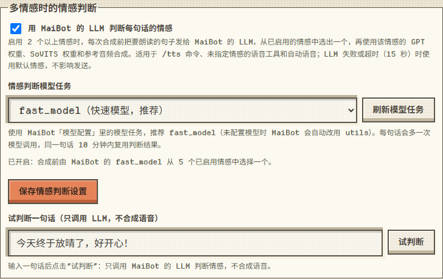

# 情感分类

角色模式下启用 **2 个以上情感** 并开启第三步的“用 MaiBot 的 LLM 判断每句话的情感”（默认开启）后，每次合成前：

1. 把要朗读的句子和已启用的情感列表发给 MaiBot 的 LLM（默认模型任务 `fast_model`；未给它配置模型时 MaiBot 会自动改用 `utils`），要求只回答一个情感 ID；
2. 用返回的情感在 `role.json` 中对应的 GPT 权重、SoVITS 权重和参考音频合成（与当前已加载的不同才切换权重）；
3. LLM 调用失败、超时（15 秒）或回答不在已启用情感中时，使用默认情感，照常合成发送。

| 合成方式 | 情感来源 |
|---|---|
| `/tts 文本` | LLM 判断 |
| 语音工具传了 `emotion` | 使用指定的情感（不调用 LLM） |
| 语音工具没传 `emotion` | LLM 判断 |
| 自动语音 | 消息自带情感标记时直接使用；否则 LLM 判断，失败时再按关键词规则；第五步关闭“跟随回复情感”时始终用默认情感 |
| 设置页试听 | 默认试听情感 |

- 只启用 1 个情感，或关闭该选项时，不会调用 LLM。
- 每句话会多一次 LLM 调用（实测约 2～4 秒，取决于所用模型）；同一句话 10 分钟内复用判断结果。
- 第三步可以选择其他模型任务、点击“试判断”测试一句话（只调用 LLM，不合成语音）；最近一次判断的结果和失败原因会显示在页面和“当前配置检查”里。

自动语音回复中“跟随回复情感”的规则见 [使用](usage.md) 中的“自动语音回复”。
