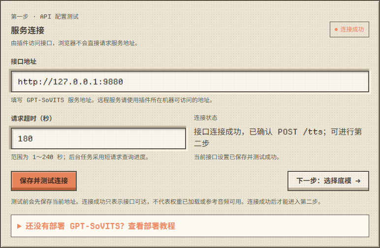
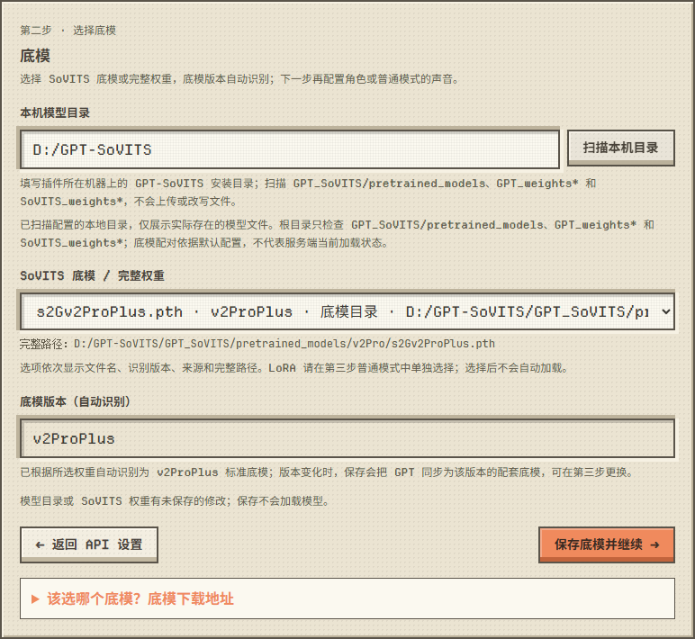
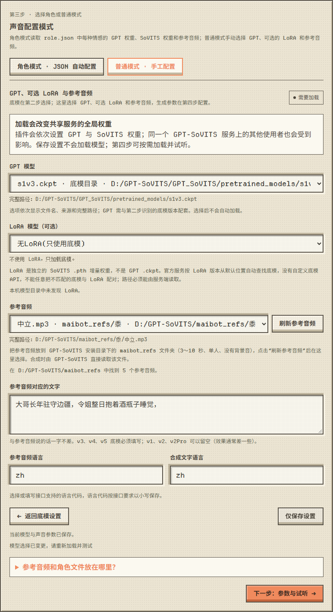
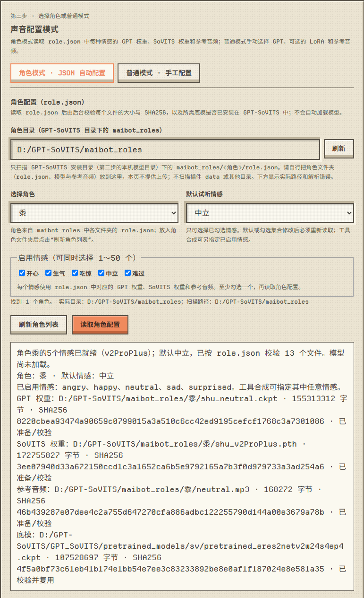
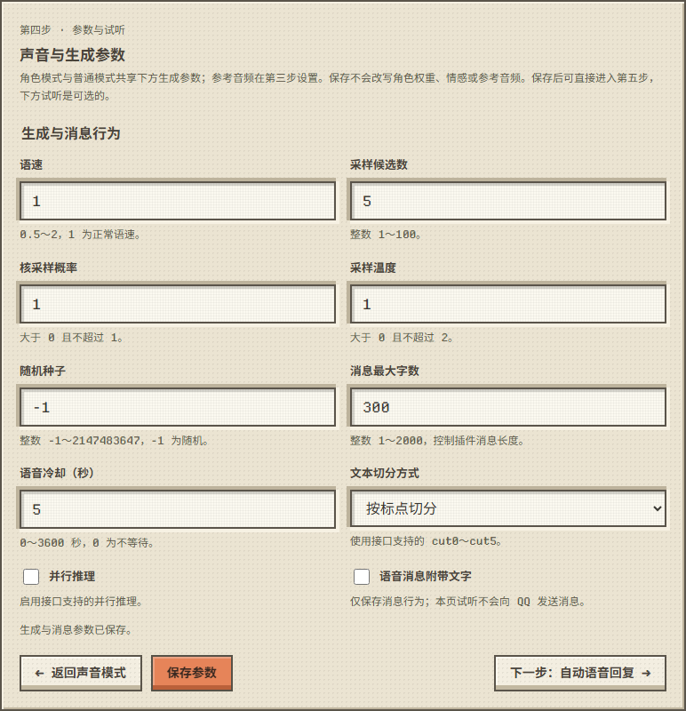
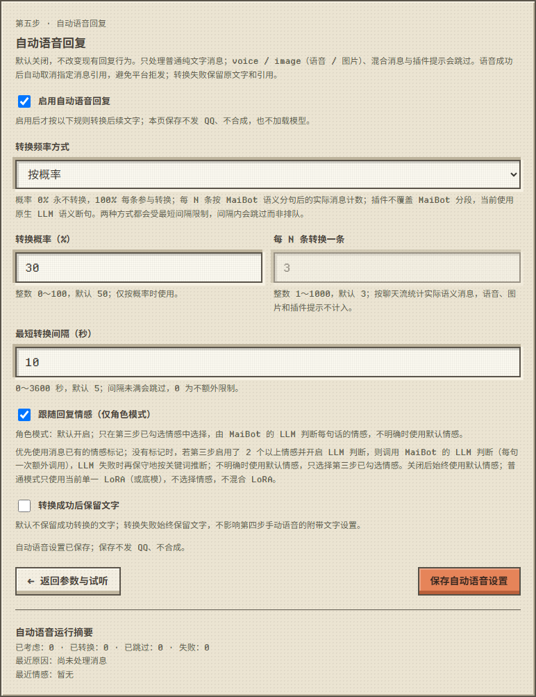
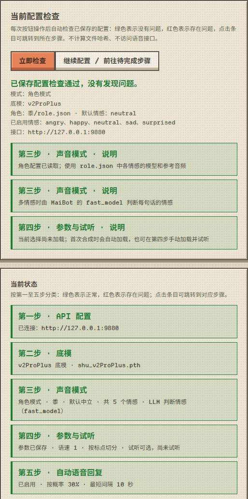

# 五步设置

设置页在 MaiBot WebUI 顶部的 **GPT-SoVITS 语音设置** 工作区。左侧按“接口 → 底模 → 声音模式 → 参数与试听 → 自动语音”分为五步；右侧的“当前配置检查”和“当前状态”实时显示每一步是否正常，点击条目即可跳到对应步骤。

**每一步配置完成后才能进入下一步**：上一步没有完成时，顶部后面步骤的按钮和“下一步”按钮都会变灰（鼠标悬停提示先完成哪一步）；点击右侧“当前状态”或“当前配置检查”里后面的步骤，会停在第一个未完成的步骤并说明原因。已经到达过的步骤可以随时返回修改；修改后没有保存时，也要先保存才能继续往后。各步的“完成”指：

- 第一步：接口测试成功（之前测试成功过且地址没改时，打开页面会自动确认；确认失败则需要重新测试）。
- 第二步：本机模型目录与 SoVITS 底模已保存，且目录扫描正常。
- 第三步：角色模式已读取当前角色配置（多情感时情感判断设置也已保存）；普通模式已保存 GPT 权重（LoRA 可不用）、参考音频和语言（v3/v4/v5 底模还需参考文字）。
- 第四步：参数已保存。试听是可选的，不影响进入第五步。

## 第一步：接口

- 填写 `api_v2.py` 的地址（默认 `http://127.0.0.1:9880`）和请求超时，点击“保存并测试连接”（先保存再测试）。
- 测试只确认接口提供 `POST /tts`，不会加载模型或合成语音。之后再进入页面时会自动做一次只读连接确认（最多 3.5 秒）。
- 还没有部署 GPT-SoVITS？展开下方的“查看部署教程”，内容与 [部署 GPT-SoVITS](gpt-sovits.md) 相同；连接测试失败时会自动展开。

## 第二步：底模

- 填写 **本机模型目录**（GPT-SoVITS 安装目录）并点击“扫描本机目录”，在下拉框中选择 SoVITS 底模或完整权重，选项依次显示文件名、版本、来源和完整路径。没有选择时“保存底模并继续”不可点击。
- **底模版本自动识别**（页面显示与保存时后台使用同一规则）：
  1. 所选文件正是本机已安装的某个标准底模（如 `pretrained_models/gsv-v5-pretrained/s2Gv5turbo.pth`）→ 该版本；
  2. 扫描到的完整训练权重 → 读取文件头得到的版本（本机需已安装该版本的标准底模）；
  3. 其余无法确认的情况 → 显示为“自定义权重”。此时仍可合成，但不能叠加 LoRA。
- 保存时如果版本发生变化，GPT 会同步为该版本的配套底模、已选 LoRA 会被清空；版本不变时保留你在第三步手选的 GPT 和 LoRA。
- 不知道选哪个、或者还没有底模：展开下方的“该选哪个底模？底模下载地址”，见 [部署 GPT-SoVITS](gpt-sovits.md) 中的“底模选择与下载”。

## 第三步：声音模式

两种模式二选一，参考音频和角色文件的放置方法见 [音色克隆](voice-cloning.md)（第三步下方也有这份说明，没有可选的参考音频或角色时会自动展开）。

**普通模式（零样本音色克隆）**：选择 GPT 权重、可选的 LoRA 和参考音频。参考音频放在 GPT-SoVITS 安装目录下的 `maibot_refs`，点击“刷新参考音频”后从下拉框选择；再填写参考音频对应的文字（v3、v4、v5 底模必填，要与音频内容一字不差）和语言，点击“仅保存设置”。

**角色模式（多情感）**：把角色文件夹放到 GPT-SoVITS 安装目录下的 `maibot_roles`，选择角色和要启用的情感，点击“读取角色配置”。后台会按 `role.json` 校验每个文件的大小与 SHA256，以及所需底模是否已安装，全部通过后才套用；任何一项失败都不会修改现有配置。

启用 2 个以上情感时，在同一页设置情感分类并点击“保存情感判断设置”，见 [情感分类](emotion-classification.md)。

## 第四步：参数与试听

- 语速、采样候选数（top_k）、核采样概率（top_p）、采样温度、随机种子、消息最大字数、语音冷却、文本切分方式、并行推理、语音消息是否附带文字；角色模式和普通模式共用这些参数。默认参数也需要点一次“保存参数”。
- 同一页下方可以**选择性**加载模型并生成试听（可播放和下载，不发送到聊天）；不试听也可以直接进入第五步。加载会切换 GPT-SoVITS 服务的全局权重。

## 第五步：自动语音

是否启用、转换频率（按概率或每 N 条）、最短转换间隔、是否跟随回复情感（角色模式）、转换成功后是否保留文字。默认关闭，保持关闭也需要保存一次。详见 [使用](usage.md) 中的“自动语音回复”。

## 当前状态与配置检查

- 右栏 **当前状态** 按第一至五步分类显示：**绿色** 表示正常，**红色** 表示存在问题，灰色表示正在读取、确认或任务进行中。点击任意条目会跳转到对应步骤。
  - 第一至三步：接口连接、底模（含扫描失败、版本不一致）、角色读取 / 普通模式 GPT、LoRA 与参考音频（含缺少参考音频或语言、v3/v4/v5 底模缺少参考文本）；多情感角色还包括情感判断设置未保存、最近一次 LLM 判断失败。
  - 第四步：参数有未保存的修改、参数尚未保存过、模型加载或试听失败。没有试听**不算问题**，只显示“试听可选，尚未试听”。
  - 第五步：有未保存的修改、尚未保存过（保持关闭也需保存一次）、最近一次自动语音转换失败。
- 右栏 **当前配置检查** 会在每次按钮操作、后台任务结束和连接确认后**自动检查**已保存的配置（也可点“立即检查”）。没有问题时显示绿色；有错误或提醒时显示红色并列出问题，每个条目注明所属步骤，点击即可跳转。检查进行中再次触发会合并为一次补查。
  - “当前选择尚未加载”：角色模式，或普通模式开启自动语音且已配置权重时，合成前会自动加载，只作为绿色说明；普通模式未开启自动语音时 `/tts` 会沿用服务端当前权重，因此显示为红色提醒。
- 按钮操作失败时，**原因显示在页面左栏最下方**（注明是第几步的操作），顶部只提示“操作失败”。点击“关闭提示”或进行下一次操作时提示会清除。

页面会记录已完成的步骤（`data/.state/wizard-progress.json`），再次打开时恢复到上次的进度，但不会越过未完成的步骤；修改接口、底模或角色后，相关步骤会重新标记为未完成。MaiBot 重启后，角色模式需要在第三步重新点一次“读取角色配置”才能继续往后。

MaiBot「插件配置」页中的原生配置表单也能修改这些设置，并提供“测试已保存接口 / 刷新模型列表 / 读取已保存角色 / 加载已保存模型”四个按钮（都只使用已保存的配置）；日常配置推荐使用上面的五步设置页。
